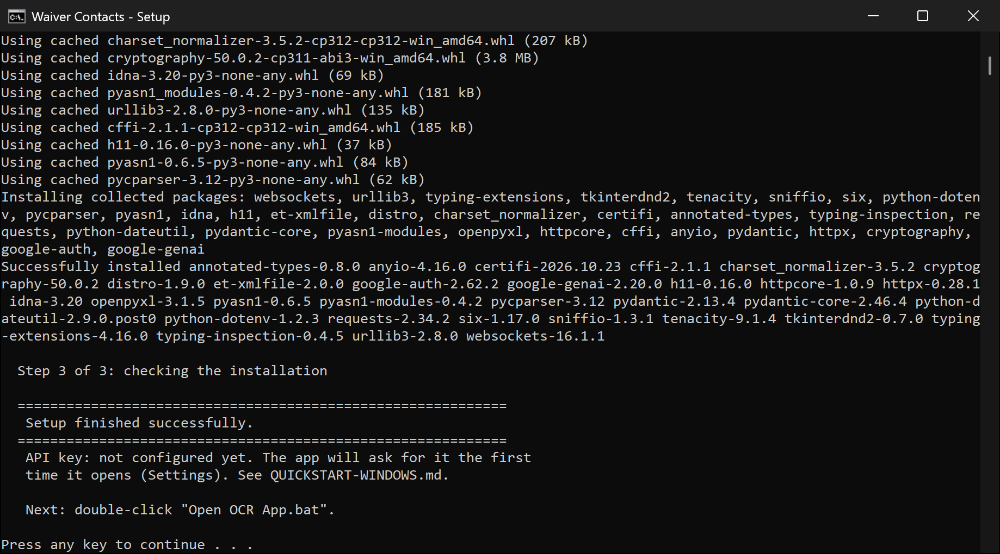
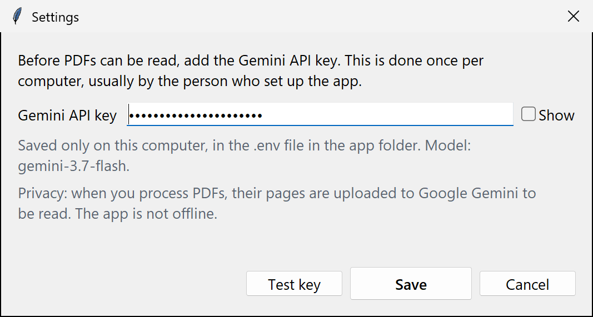
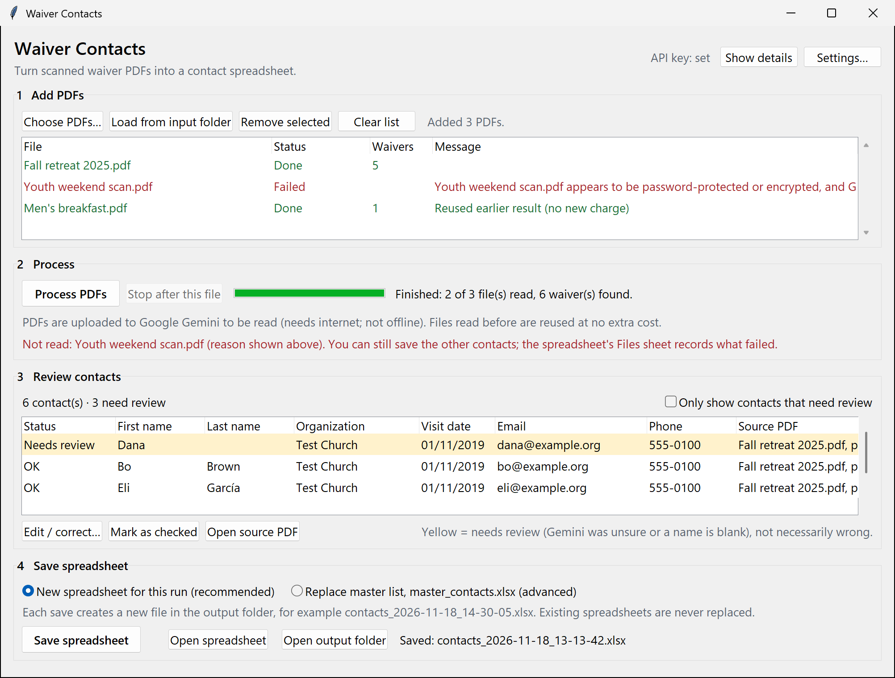
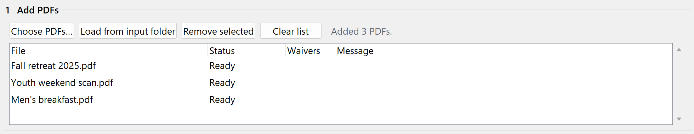
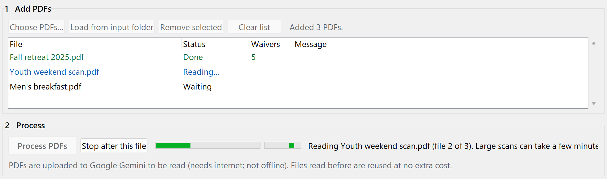
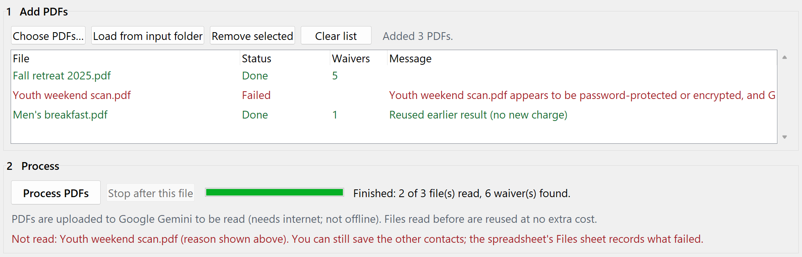
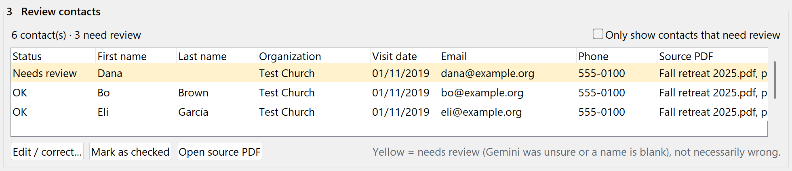
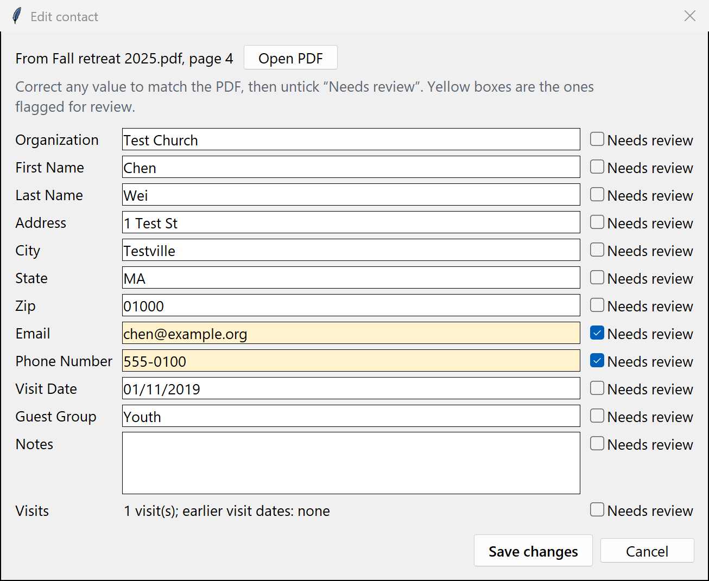
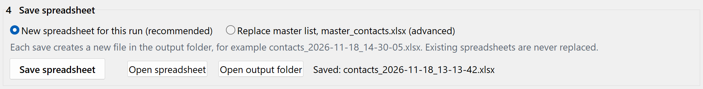

# Waiver Contacts: Windows quick start

This app reads scanned waiver PDFs and turns them into an Excel contact list. You don't need to type any commands.

> **Privacy:** the app sends the PDFs you choose to Google Gemini over the internet to read the handwriting. It does not work offline. Only process waivers you are allowed to share with Google's Gemini service.

## 1. Copy the folder to the computer

The person who manages the app gives you the app folder, or a `.zip` of it. If it's a zip, right-click it, choose **Extract All…**, and then use the extracted folder.

Put the `Waiver Contacts` folder somewhere permanent with a short location, such as `Documents\Waiver Contacts` or `C:\Waiver Contacts`. Spaces in the folder name are fine. A very long location can make setup fail; if that happens, setup tells you.

**To prepare a copy for someone else (app manager):** double-click **`Prepare Distribution.bat`**. It makes a clean copy, plus a zip, inside the `dist` folder. Give out that copy, not your working folder.

| Copied | Left out on purpose |
| --- | --- |
| The app files (`.py`, `.bat`, `prompt.md`, `requirements.txt`, the guides) | `.venv`: it only works on the computer that made it. Setup builds a new one. |
| Empty `input` and `output` folders | `.env`: this holds the **API key**. |
| `.env.example` (has no real key) | `input`: the real waiver PDFs. |
| | `output`: previous spreadsheets. |
| | `extracted`: saved reading results, which contain personal data. |
| | `logs`, `__pycache__`, `source_links.json` |

If you copy the folder by hand instead, leave out the items in the right-hand column.

## 2. Run setup (once per computer)

1. Double-click **`Setup.bat`**.
2. A black window shows the progress. It needs the internet and can take a few minutes.
3. When it says **Setup finished successfully**, press any key to close it.

If it says **Python … was not found**:

1. Go to <https://www.python.org/downloads/windows/>.
2. Download the latest **Windows installer (64-bit)** and run it.
3. On the installer's first screen, tick **Add python.exe to PATH**, then click **Install Now**.
4. Double-click `Setup.bat` again.

You can run `Setup.bat` again at any time. It's safe, and it repairs most problems.

## 3. Add the API key (app manager, once per computer)

Users don't need their own Google account or key. The app manager adds one shared key on each computer:

1. Open the app (step 4). If no key is saved yet, the **Settings** window opens by itself. You can also open it at any time with **Settings…** in the top-right corner.
2. Paste the Gemini API key. The key is hidden as dots; tick **Show** to check it.
3. Click **Test key**. This checks the key without reading any PDF. Then click **Save**.

The key is saved only in the `.env` file in the app folder on that computer.

- Never email the `.env` file.
- Never put the `.env` file in a shared or synced folder.
- Never commit it to Git.

`Prepare Distribution.bat` never copies it. To change or remove the key later, use **Settings…**, or edit `.env` with Notepad.

## 4. Open the app

Double-click **`Open OCR App.bat`**. A small black window flashes, then the app opens. You work through its four numbered sections from top to bottom.

If it says **the app is not set up on this computer yet**, run `Setup.bat` first.

**Need help inside the app?** Click the orange **?** character in the top-right corner, or press **F1**. Pick a topic and it points at each button and explains it, one step at a time (**Back**, **Next**, **Close**). It only explains: it never processes, saves or changes anything. You can hide it with **Hide me**; press F1, or tick **Show the ? help button** in **Settings…**, to bring it back.

## 5. Use the app

The pictures below use made-up files and names.

**1. Add PDFs**

You have three ways to add files:

- Click **Choose PDFs…**.
- Drag PDF files, or a folder of PDFs, onto the list.
- Click **Load from input folder** to add every PDF in the app's `input` folder.

Adding the same file twice is blocked. **Remove selected** and **Clear list** only take files off the list; your PDFs are never moved, changed or deleted.

**2. Process**

1. Click **Process PDFs**.
2. Wait while the app works through the list. It shows which file it's reading and how many are finished. A large scan can take a few minutes.
3. To stop, click **Stop after this file**. The app finishes the file it's reading, then stops.

A file that was already read before is reused at no extra cost.

If a file fails, the reason is shown next to it in red, and the other files still finish. Double-click a file to see the full message.

**3. Review**

- **Yellow rows need review.** Either Gemini was unsure about some handwriting, or a name is blank. Yellow means "please look", not "wrong".
- Each row shows which PDF and page it came from. **Open source PDF** opens that file.
- Double-click a row, or click **Edit / correct…**, to fix values. Fields flagged for review are yellow. When a value matches the PDF, untick **Needs review**.
- **Mark as checked** clears all review flags on the selected rows.
- Tick **Only show contacts that need review** to work through just the flagged ones.

In the correction window, the fields to check are yellow and ticked **Needs review**:

Your corrections go into the spreadsheet when you save.

**4. Save**

1. Leave **New spreadsheet for this run** selected (the normal choice).
2. Click **Save spreadsheet**. Every save creates a new file, such as `contacts_2026-11-18_14-30-05.xlsx`. Existing spreadsheets are never replaced.
3. Click **Open spreadsheet** to open it in Excel, or **Open output folder** to see all the files.

If some PDFs failed, you can still save the others. The spreadsheet's **Files** sheet lists every PDF and what happened to it.

**Replace master list (advanced)** updates the single `output\master_contacts.xlsx` file that the command-line tool also writes. The app asks before replacing it and first saves a backup copy in `output\backups`. Contacts that were only in the old master file are not carried over.

## 6. Where files are

| What | Where (inside the app folder) |
| --- | --- |
| Saved spreadsheets | `output\` |
| Backups of the master list | `output\backups\` |
| Saved reading results (so files aren't charged twice) | `extracted\` (contains personal data) |
| Technical log for troubleshooting | `logs\app.log` |

## 7. Common problems

| Message or problem | What to do |
| --- | --- |
| **API key not accepted** | Open **Settings…**, paste the key again, and click **Test key**. If it still fails, ask the app manager for a new key. |
| **No connection to Gemini** | Check the internet connection, then click **Process PDFs** again. |
| **Gemini limit reached** | Wait a few minutes and process again. Files that already finished are not charged again. If it keeps happening, the app manager should check the key's quota and billing. |
| **File can't be used / not a PDF / PDF is protected** | Re-scan the waiver, or open it and save it again as a normal PDF without a password. PDFs over 50 MB must be split. |
| **Spreadsheet is open or locked** | Close the spreadsheet in Excel, then click **Save spreadsheet** again. |
| Spreadsheet saved but didn't open | Excel may not be installed. Use **Open output folder** and open the file with another program. |
| **The app is not set up on this computer yet** | Run `Setup.bat`. |
| Drag-and-drop doesn't work | Use **Choose PDFs…**. Running `Setup.bat` again usually fixes it. Drag-and-drop also doesn't work if the app was started "as administrator". |
| The app won't open at all | Run `Setup.bat` again. If it still fails, send the app manager the file `logs\startup-error.log`. |
| Something else | Click **Show details** in the top-right corner of the app, or look at `logs\app.log`. Neither contains the API key or the waiver contents. |
